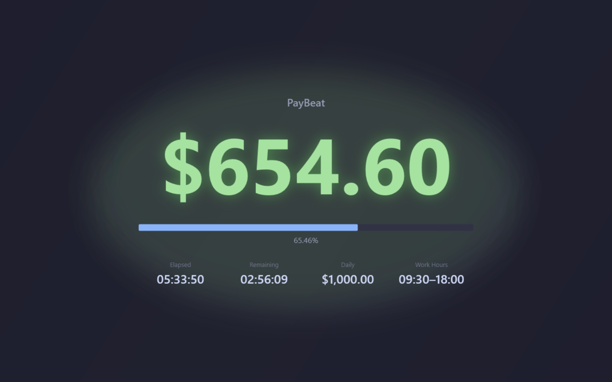

# PayBeat

[](https://github.com/coldhighsun/PayBeat/actions/workflows/ci.yml)
[](https://github.com/coldhighsun/PayBeat/releases/latest)
[](https://github.com/coldhighsun/PayBeat/releases)
[](https://dotnet.microsoft.com/download/dotnet/10.0)
[](https://www.microsoft.com/windows)
[](LICENSE)
[](https://github.com/coldhighsun/PayBeat/issues)
[](https://github.com/coldhighsun/PayBeat/pulls)
[](https://github.com/coldhighsun/PayBeat/commits/main)
[](https://github.com/coldhighsun/PayBeat/stargazers)

[English](README.md) | **简体中文**

Windows 实时工资进度悬浮组件

---

## 简介

PayBeat 是一款 Windows 桌面悬浮组件，以秒为单位实时显示当天已挣到的工资。  
窗口无边框、始终置顶，不占用任务栏，适合放在屏幕角落随时瞥一眼。

## 功能

- 根据日薪和工作时段，每秒线性计算已赚金额，支持跨午夜的夜班排班（如 22:00–06:00）
- 四种显示模式（None / Normal / Mini / Flex），双击打开设置
- Flex 模式为全屏"炫耀"视图，超大金额数字、完整工时统计，配有动态背景动画
- 每种模式独立记忆上次所在位置（支持多显示器）
- 系统托盘图标，右键菜单可切换显示模式、打开设置 / 关于、退出；左键点击会将悬浮窗置于最前并闪烁放大提示
- 全局热键一键显示 / 隐藏（默认 `Ctrl+Alt+X`）
- 可选午休扣除时段，可选周末计薪
- 托盘气泡通知：下班提醒、赚钱里程碑提醒、新版本提醒——点击新版本提醒气泡可直接打开发布页面
- 启动时检查 GitHub Releases 是否有新版本（每天最多检查一次）
- 支持中英文界面，随系统语言自动切换
- 支持浅色 / 深色主题，随系统外观设置自动切换
- 可设置透明度、刷新间隔、货币符号；数字格式跟随 Windows 系统区域设置（千分位/小数点分隔符）
- 支持开机自启

## 界面截图

| Flex | Normal | Mini |
|------|--------|------|
|  |  |  |

## 系统要求

- Windows 10 / 11（x64）
- 便携版：需安装 [.NET 10 Runtime](https://dotnet.microsoft.com/download/dotnet/10.0)
- 独立版：无需安装任何运行时，开箱即用

PayBeat 基于 [Avalonia](https://avaloniaui.net/) 构建，代码本身是跨平台的。目前官方发布包仅提供 Windows 版本；macOS / Linux 版本尚未测试；平台相关功能（全局热键、开机自启动、置顶强化）在这些平台上会降级为空实现。

## 下载

前往 [Releases 页面](https://github.com/coldhighsun/PayBeat/releases/latest) 下载最新版本。每个版本会发布三个 `win-x64` 安装包：

- `PayBeat-<version>-portable-runtime-required-win-x64.zip` — 体积较小，需预装 .NET 10 Runtime
- `PayBeat-<version>-portable-standalone-win-x64.zip` — 体积较大，内置运行时，无需任何前置依赖
- `PayBeat-<version>-setup-win-x64.exe` — 内置运行时的安装程序，无需前置依赖；按当前用户安装，创建开始菜单快捷方式并支持卸载

## 构建

```bash
# 构建
dotnet build

# 运行
dotnet run --project src/PayBeat.App/PayBeat.App.csproj

# 发布（便携版）
dotnet publish src/PayBeat.App/PayBeat.App.csproj -c Release

# 发布（独立版）
dotnet publish src/PayBeat.App/PayBeat.App.csproj -c Release -r win-x64 --self-contained

# 生成安装包（需要 Inno Setup 7，且需先生成独立版发布产物至 publish-selfcontained/）
dotnet publish src/PayBeat.App/PayBeat.App.csproj -c Release -r win-x64 --self-contained -o publish-selfcontained/
ISCC.exe installer\PayBeat.iss /DAppVersion=1.2.3
```

产物输出至 `artifacts/bin/PayBeat.App/release/`。CI 打标签时会同时生成 `PayBeat-<version>-portable-runtime-required-win-x64.zip`、`PayBeat-<version>-portable-standalone-win-x64.zip` 和 `PayBeat-<version>-setup-win-x64.exe` 三个发布包。

## 使用

1. 启动后，悬浮窗出现在屏幕右下角
2. **双击**窗口打开设置界面
3. **拖拽**窗口到任意位置，退出时自动保存
4. **右键**打开菜单，可进入设置或关于页面
5. **托盘图标**提供同样的菜单，另可切换显示模式、退出程序；左键点击会将悬浮窗置于最前并闪烁放大提示
6. 在设置中填写日薪、工作时段、货币符号，保存后立即生效

## 设置说明

| 选项 | 默认值 | 说明 |
|------|--------|------|
| 日薪 | 500 | 每个工作日的税前薪资（支持小数，最大 99,999,999） |
| 上班时间 | 09:00 | 开始计薪的时刻 |
| 下班时间 | 18:00 | 薪资封顶的时刻；设为早于上班时间即为夜班排班 |
| 货币符号 | ¥ | 显示在金额前的符号 |
| 显示模式 | Normal | 初始显示模式（None / Normal / Mini / Flex） |
| 刷新间隔 | 1 秒 | 界面更新频率（1–60 秒） |
| 透明度 | 0.8 | 鼠标不悬停时的窗口不透明度（0.1–1.0） |
| 主题 | Auto | 界面配色（Auto / Light / Dark），Auto 跟随系统外观设置 |
| 全局热键 | Ctrl+Alt+X | 显示 / 隐藏全部窗口 |
| 开机自启 | 关 | 登录 Windows 后自动启动 |
| 扣除午休 | 关 | 从计薪时段中排除一段每日午休时间（默认 12:00–13:00） |
| 周末计薪 | 关 | 关闭时，周六、周日不计薪 |
| 下班提醒 | 关 | 下班前若干分钟发送托盘气泡提醒（默认 5 分钟） |
| 里程碑提醒 | 关 | 每赚够一定金额发送托盘气泡提醒（默认 ¥100） |

## 许可证

MIT
